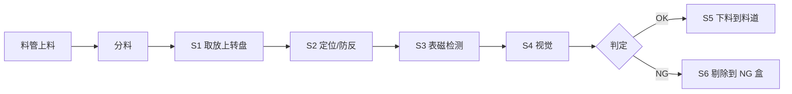

# 机构方案输出模板

Use in Step 11. In chat, output Markdown in this order. For a Word document, use the same chapters with the `docx` and `office-report` skills; for slides, use the "一页纸" and "评审 PPT" structures with the `pptx` skill; put calculations, cycle table and BOM in an `xlsx` workbook with inputs on a `参数` sheet.

## A. 方案说明书结构

1. **结论摘要** (3~5 句): 推荐方案、节拍/UPH 及余量、关键精度、预算区间、主要风险.
2. **项目概述**: 产品、工序、产能目标、关键指标.
3. **需求与假设条件**: 表格, 区分 "已确认" 和 "假设".
4. **工艺流程**: 流程图 + 动作表.
5. **总体布局**: 3D 概念布局截图 (轴测 + 俯视)、外形尺寸、工位分布、物流方向、操作侧、OK/NG 出口; 附 HTML 预览和 STEP 文件.
6. **关键机构说明**: 每个机构一节, 用 B 模板.
7. **选型计算书**: `mech_calc.py` 结果表, 注明安全系数和待样本复核项.
8. **节拍分析**: CT、UPH、余量、关键路径、甘特图、瓶颈与提速措施.
9. **方案对比与推荐** (多方案时): 对比表 + 加权评分 + 敏感性.
10. **风险与对策**: 简化 FMEA 表.
11. **BOM 与成本估算**: C 模板.
12. **待确认事项与下一步**: 谁、做什么、输出什么、何时.

## B. 单个机构说明模板

```markdown
### 机构 3: 表磁检测机构 (S3 工位)
- 功能: 测量磁环外圆 24 极表磁峰值, 判定 OK/NG
- 构成: 伺服电机 100 W + 同步带 1:2 带动芯轴旋转; 霍尔探头装在气缸滑台上, 硬限位定距; 编码器触发采样
- 动作顺序: ① 转盘到位 → ② 探头进给 (0.20 s) → ③ 芯轴旋转 360° 同步采样 (0.60 s) → ④ 探头退回 (0.20 s) ‖ 计算判定 (0.10 s)
- 关键参数: 探头间隙 0.5 ± 0.02 mm, 采样 ≥ 20 点/极, 单件 1.0 s
- 选型依据: 伺服扭矩/惯量见计算书 §3; 滑台气缸 Φ10 负载率 0.32
- 精度保证: 芯轴定位内孔, 跳动 ≤ 0.01 mm; 探头支架用铝合金, 50 mm 内无钢件 (已对比验证)
- 风险与对策: 温度漂移 → 温度传感器补偿; 铁屑吸附 → 前工位吹气清洁
```

## C. BOM / 成本表

| 模块 | 名称 | 型号规格 | 品牌 | 数量 | 单价 (元) | 小计 (元) | 价格来源 |
|---|---|---|---|---:|---:|---:|---|
| 转盘 | DD 马达 | 额定 xx N·m | 待定 | 1 | | | 估算 |
| 上料 | 滑台气缸 | Φ10 × 30 | 待定 | 2 | | | 报价 |
| ... | | | | | | | |
| 合计 (外购件) | | | | | | | |
| 机加工件 | | 按模块估重/估工时 | | | | | 估算 |
| 电气与控制 | | PLC/伺服驱动/传感器/线材 | | | | | 估算 |
| 设计调试与不可预见 | | 10%~15% | | | | | — |

Rules: 价格来源必须标注 (报价/估算/历史价); 长周期件在备注中标出交期.

## D. 一页纸汇报 (manager)

```markdown
**结论**: 推荐 6 工位 DD 转盘方案, 节拍 1.45 s, 实际产能 2100 UPH (目标 1800, 余量 15%), 设备预算约 xx 万元。
**方案要点**: 料管上料避免磁环互吸; 芯轴定位 + 硬限位定距保证表磁重复性; NG 失效安全剔除。
**主要风险**: ① 表磁重复性 → 样机阶段做 GR&R; ② 料管补料频率 → 料管容量 ≥ 30 min。
**需要决策**: ① 是否接受料管来料 (需供应商配合); ② 预算是否按 xx 万元立项。
**下一步**: 本周完成 3D 布局, 下周关键件询价, 第 4 周样机。
```

## E. 评审 PPT 结构

1. 标题页 (结论式副标题)
2. 需求与目标 (产能、精度、检测项)
3. 总体布局图 (3D 轴测 + 俯视截图)
4. 工艺流程与工位分配
5. 关键机构 (每个关键机构 1 页: 结构图 + 参数 + 选型依据)
6. 节拍甘特图与瓶颈
7. 方案对比与推荐
8. 风险与对策
9. 成本与进度
10. 需决策事项

## F. 布局草图写法

Preferred: the 3D concept layout from `scripts/layout3d.py` (see `layout-3d.md`): 轴测截图 for the overview, 俯视 + 平行投影 截图 as the layout drawing, plus the HTML and STEP files. When no files can be produced, give a top view in ASCII or Mermaid, with material flow and operator side:

```text
                 [S2 定位]
     [S1 上料]                [S3 表磁检测]
  料管→分料→      ( 转盘 6 工位 )
     [S6 NG剔除]              [S4 视觉]
                 [S5 OK下料]→ 料道
  ───────────── 操作侧 (光栅 / HMI) ─────────────
```


